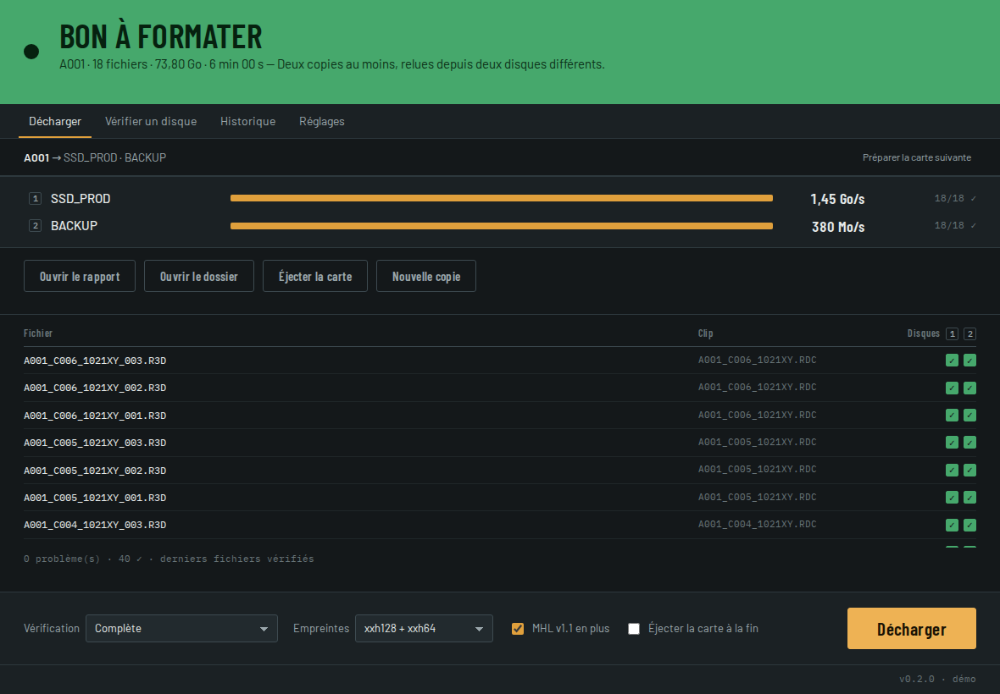
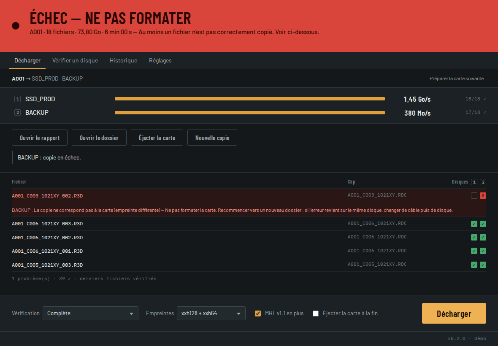
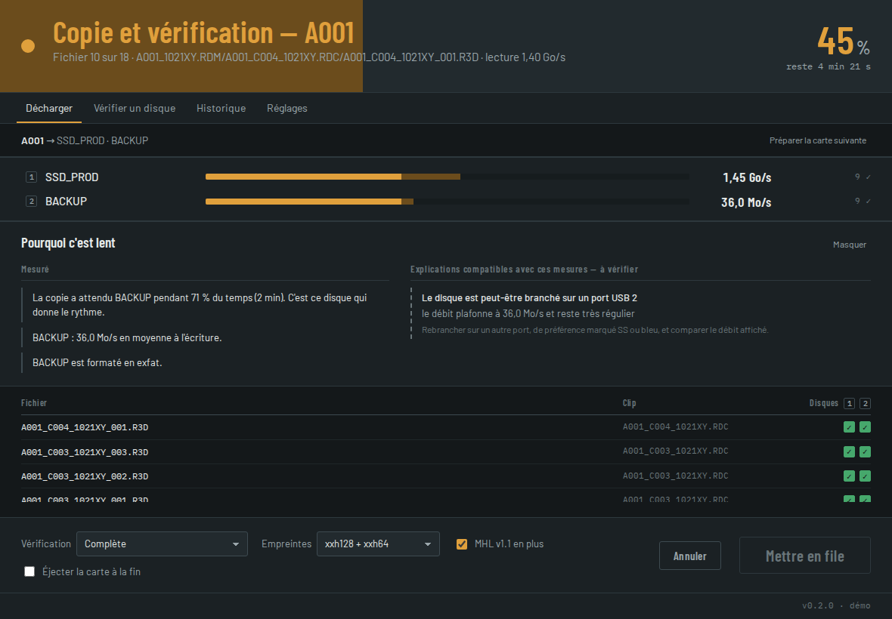

# SuperLoc Offload

Outil gratuit de déchargement de cartes caméra, pour Mac et Windows. Il copie
une carte vers plusieurs disques en une seule lecture, **relit chaque copie
depuis le disque**, écrit les manifestes standard de la profession
(**ASC MHL**, et MHL v1.1) et dit sans ambiguïté si la carte peut être
formatée.



## Le verdict

| Bandeau | Signification |
|---|---|
| **BON À FORMATER** (vert) | Au moins deux copies, sur deux disques physiques différents, dont chaque fichier a été relu depuis le disque et trouvé identique à la carte. |
| **COPIE CONFORME — NE PAS FORMATER ENCORE** (ambre) | Les copies sont identiques à la carte, mais une condition manque : une seule copie, deux copies sur le même disque, relecture non prouvée, mode « taille seule »… La raison est écrite sous le bandeau. |
| **ÉCHEC — NE PAS FORMATER** (rouge) | Au moins un fichier n'est pas correctement copié. Chaque problème nomme le fichier, le disque et ce qu'il faut faire. |
| **ANNULÉ** (rouge) | Les fichiers déjà vérifiés sont conservés, les autres n'ont pas été copiés. |

Le vert ne vient que du moteur, jamais d'une décoration.

| Échec, avec le fichier et l'action | Diagnostic de lenteur |
|---|---|
|  |  |

## Ce qui est garanti, et comment

- **La carte n'est jamais modifiée.** Elle est ouverte en lecture seule ;
  aucun manifeste n'y est déposé. Un test le vérifie à chaque version.
- **Rien n'est écrasé.** Un dossier de destination existant est refusé (un
  nom libre est proposé) ; chaque fichier est créé en exclusivité.
- **Un fichier n'a son nom définitif qu'après vérification.** Pendant la
  copie il s'appelle `….offload-part` ; un échec ou une annulation le
  supprime.
- **La relecture vient du disque, et c'est mesuré.** Après l'écriture et sa
  synchronisation, le fichier est chassé du cache du système, puis l'outil
  **mesure** qu'il n'en reste aucune page en mémoire avant de le relire.
  Sur macOS, le seul drapeau « sans cache » ne suffit pas (le noyau sert
  quand même les pages déjà en mémoire) : c'est pourquoi la v0.2 mesure. Le
  niveau obtenu est consigné fichier par fichier dans le rapport.
- **Les manifestes sont validés par l'outil officiel de l'ASC** (`ascmhl`) à
  chaque construction, y compris les empreintes de dossiers.
- **Les pannes sont testées pendant la copie**, pas après : bit retourné à
  l'écriture, disque plein, disque débranché, écriture perdue, secteur
  illisible sur la carte, carte modifiée pendant la lecture, relecture de la
  carte différente, annulation.
- **Contrôles avant d'écrire quoi que ce soit** : espace libre (par volume),
  fichiers de plus de 4 Gio vers un disque FAT32, noms refusés par Windows,
  collisions de noms (accents, majuscules), disque en lecture seule (NTFS sur
  Mac), destination dans la carte.
- **Copie conforme de la structure** : dossiers vides, fichiers de 0 octet,
  dates de modification. Seuls les fichiers déposés par le système
  (`.Spotlight-V100`, `._*`, `System Volume Information`…) sont écartés, et
  listés dans le rapport.

Le détail est dans [docs/CONCEPTION.md](docs/CONCEPTION.md), les sources dans
[docs/SOURCES.md](docs/SOURCES.md).

## Ce que l'outil écrit sur chaque disque

```
2026-10-22_A001/
  … copie conforme de la carte …
  ascmhl/0001_2026-10-22_A001_2026-10-22_081512Z.mhl
  ascmhl/ascmhl_chain.xml
  2026-10-22_A001_2026-10-22_081512.mhl      (MHL v1.1)
  _offload/rapport.html                       (imprimable en PDF)
  _offload/rapport.json
  _offload/journal.log
```

## Utilisation

Voir le [guide d'utilisation](docs/GUIDE.md) : installation sur Mac et
Windows, premier déchargement, vérification d'un disque.

En ligne de commande :

```bash
offload copier /Volumes/A001 --dest /Volumes/SSD/Rushs --dest /Volumes/BACKUP/Rushs
offload verifier /Volumes/BACKUP/Rushs/2026-10-22_A001
offload volumes
```

Codes de sortie : 0 bon à formater, 1 conforme mais ne pas formater encore,
2 échec, 3 annulé, 4 refusé avant copie.

## Développement

```
crates/offload-core   moteur (copie, vérification, manifestes, rapports)
crates/offload-cli    ligne de commande « offload »
app/src-tauri         application (Tauri 2)
app/ui                interface (HTML, CSS, JS sans dépendance)
```

```bash
cargo test -p offload-core           # tests du moteur
pip install ascmhl==1.2              # pour le test d'interopérabilité ASC
npm install && npm run dev           # application en développement
npm run build                        # installeurs
```

L'interface se prévisualise sans le moteur en ouvrant
`app/ui/index.html?demo` dans un navigateur (variantes : `?demo=echec`,
`?demo=lent`, `?demo=deja`). Sans `?demo`, elle refuse de fonctionner hors de
l'application : un simulateur qui répondrait « conforme » en silence serait
la pire panne possible.

## Licence

MIT — voir [LICENSE](LICENSE). Outil fourni en l'état, comme aide à la
vérification : gardez la carte intacte tant que deux copies vérifiées
n'existent pas sur deux disques différents.
