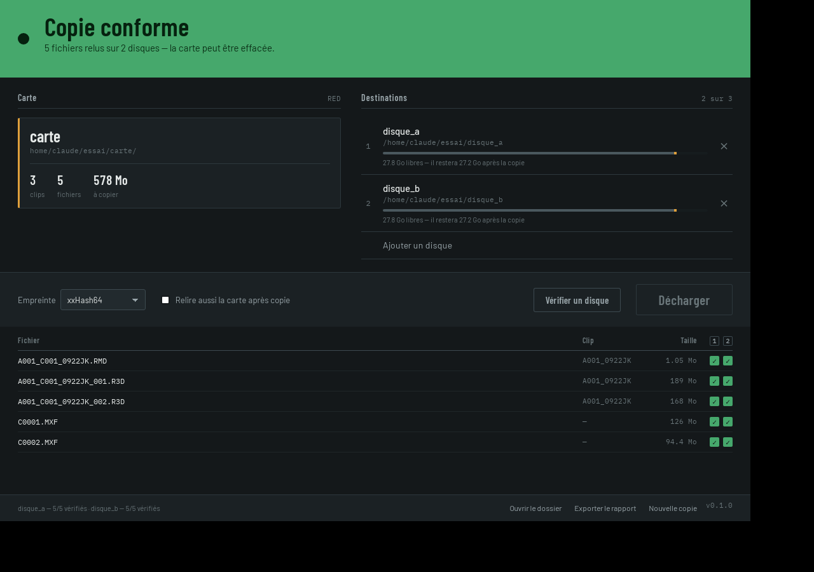
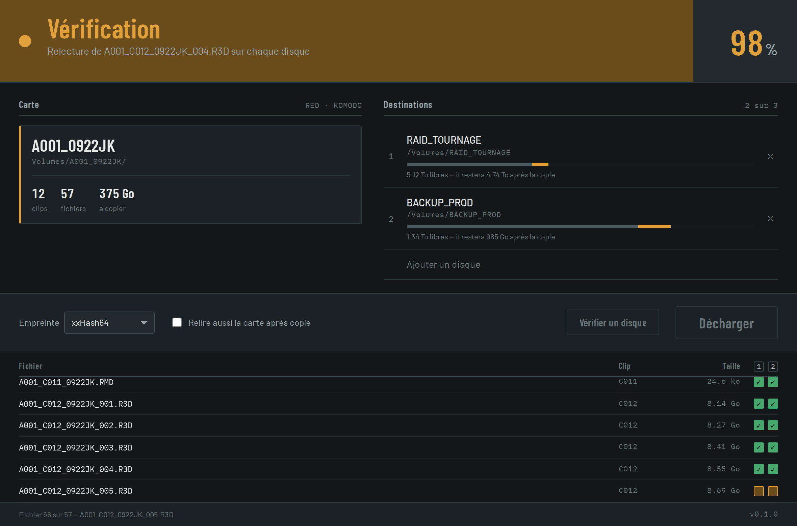
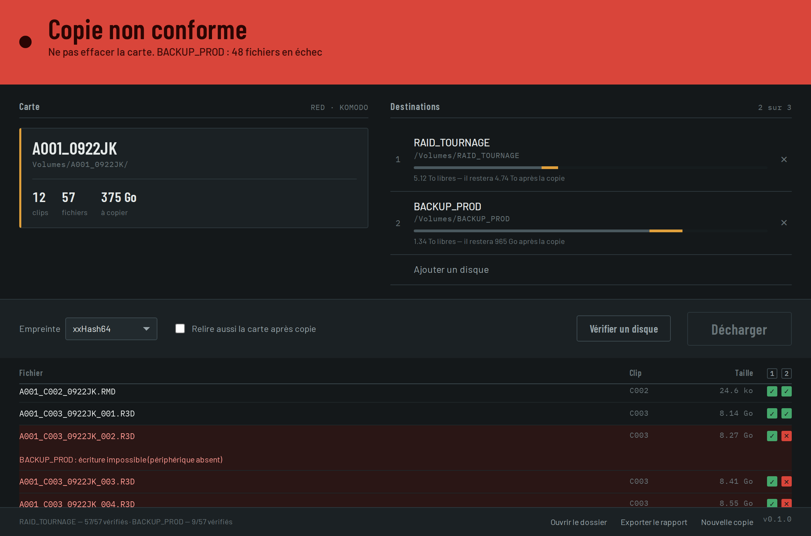

# SuperLoc Offload

Copie et vérification de rushs. L'outil décharge une carte caméra vers
plusieurs disques en une seule lecture, vérifie chaque copie en relisant
réellement le support, et laisse sur chaque disque un fichier MHL et un
rapport que le client ou la post-production peuvent revérifier plus tard.



*Fin de copie : le bandeau porte le verdict, le journal donne l'état de chaque
fichier sur chaque disque.*

| En cours | Copie non conforme |
|---|---|
|  |  |

## Ce que l'outil garantit

- **Lecture unique de la carte**, écritures en parallèle vers 2 ou 3 disques.
- **Empreinte calculée à la volée** : xxHash64 par défaut, MD5 en option.
- **Relecture depuis le support** en contournant le cache du système : sans
  cela, une vérification relit la mémoire vive et validerait une écriture
  pourtant corrompue. Le mode réellement obtenu est consigné dans le
  rapport ; s'il est dégradé, l'outil le signale au lieu d'afficher un vert
  trompeur.
- **Nom définitif après vérification seulement** : pendant la copie, chaque
  fichier porte le suffixe `.offload-part`. Une copie interrompue ne peut
  donc jamais passer pour un fichier complet.
- **Rien n'est jamais écrasé** : si le dossier de destination existe déjà,
  la copie est refusée.
- **Espace disque contrôlé avant** de commencer, pas au milieu.
- **Un disque qui tombe n'arrête pas les autres** : la copie continue et le
  rapport nomme la destination fautive.

## L'application

L'interface tient sur un seul écran : on dépose la carte, on coche les
disques, on lance. Le bandeau du haut porte le verdict et sert lui-même de
barre de progression ; le vert et le rouge n'y servent jamais à décorer, ils
ne disent qu'une chose — vérifié, ou pas.

```bash
npm install      # une fois
npm run dev      # lancer en développement
npm run build    # produire l'installeur (.dmg sur Mac, .exe/.msi sur Windows)
```

L'intégration continue construit les installeurs macOS (Intel et Apple
Silicon) et Windows à chaque envoi : ils se récupèrent dans les artefacts du
build, sans rien installer localement.

Pour remettre une version aux clients, poser une étiquette :

```bash
git tag v0.1.0 && git push --tags
```

Les tests d'intégrité tournent d'abord — on ne publie pas un outil de
vérification qui n'a pas été vérifié — puis les installeurs sont attachés à
une publication GitHub en brouillon.

### Signature

Les installeurs ne sont pas signés. Sur Mac, le premier lancement demande un
clic droit puis « Ouvrir » ; sur Windows, SmartScreen affiche un
avertissement. Les faire disparaître demande un compte développeur Apple
(99 $/an) et un certificat de signature Windows — à prévoir avant une
diffusion large aux clients.

## Utilisation en ligne de commande

```bash
# Décharger une carte vers deux disques
offload copier --source /Volumes/A001 \
               --dest /Volumes/RAID_1 \
               --dest /Volumes/BACKUP \
               --nom A001 \
               --empreinte xxh64

# Revérifier un disque des mois plus tard, à partir de son MHL
offload verifier --dossier /Volumes/RAID_1/A001
```

Options utiles :

| Option | Effet |
|---|---|
| `--empreinte xxh64,md5` | Calcule les deux empreintes en un seul passage (MD5 exigé par certaines post-productions). |
| `--verifier-source` | Relit aussi la carte après copie : détecte un lecteur de cartes défaillant. |

Code de sortie : `0` si tout est conforme, `1` sinon.

## Ce qui est déposé sur chaque destination

- `<nom>_AAAA-MM-JJ_HHMMSS.mhl` — Media Hash List v1.1, format XML normalisé
  lu par Silverstack, ShotPut Pro, DaVinci Resolve et la plupart des outils
  de DIT. N'atteste que des fichiers réellement vérifiés.
- `<nom>_rapport.json` — rapport détaillé (empreintes, résultat par
  destination, avertissements), source du futur PDF SuperLoc.

## Contournement du cache selon le système

| Système | Mécanisme |
|---|---|
| Linux | `O_DIRECT`, repli sur `posix_fadvise(DONTNEED)` |
| macOS | `fcntl(F_NOCACHE)` + `F_RDAHEAD` désactivé |
| Windows | `FILE_FLAG_NO_BUFFERING` |

Si le système refuse le contournement, la vérification est marquée dégradée
dans le rapport.

## État de validation

| Élément | État |
|---|---|
| Moteur, empreintes, MHL, détection de corruption | Testés (16 tests d'intégrité) |
| Empreintes xxHash64 | Recoupées avec une implémentation indépendante |
| Branche Linux de la lecture sans cache | Testée |
| Couche Tauri, glisser-déposer, gestion des refus | Testés de bout en bout dans l'application |
| Branches macOS et Windows de la lecture sans cache | **À valider sur machine réelle** |
| Cartes caméra réelles (RED, Sony, ARRI) | **À valider sur le parc** |

## Tests

```bash
cargo test
```

Les tests d'intégrité corrompent volontairement des copies — bit retourné,
fichier tronqué, segment de clip absent, fichier en trop, disque qui tombe
en cours de copie — et vérifient que le moteur les refuse.

## Avertissement

Cet outil est fourni sans garantie. Il ne remplace pas le contrôle humain
des rushs : ne jamais effacer une carte sur la seule foi d'un voyant vert,
sans avoir vu les images.
